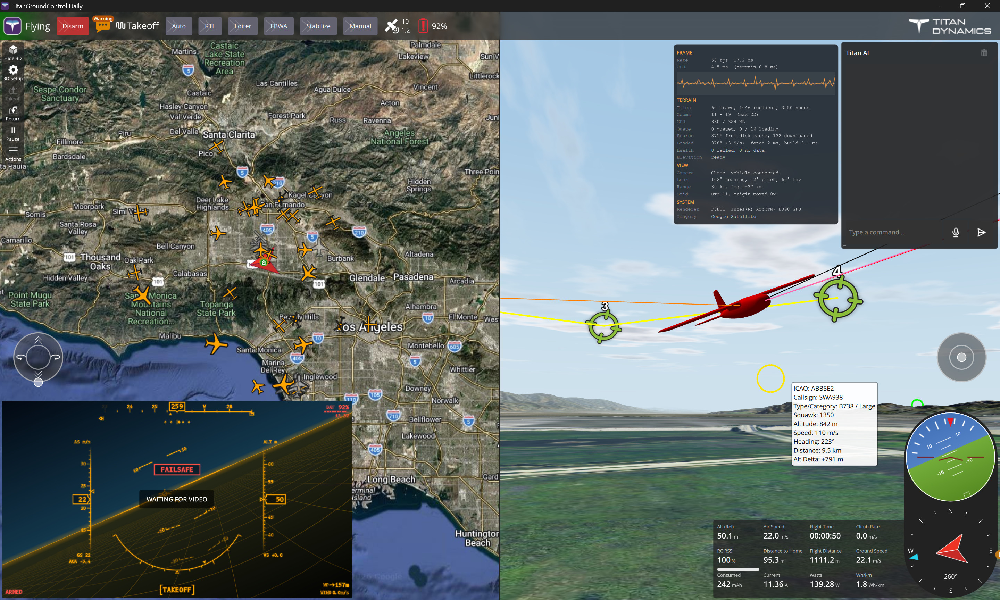

<h1 align="center">Titan Ground Control</h1>

  

**Titan Ground Control** is [Titan Dynamics'](https://github.com/Titan-Dynamics) fork of [QGroundControl](https://github.com/mavlink/qgroundcontrol), the open-source ground control station for MAVLink-enabled drones. It keeps everything QGC offers, including flight control, mission planning and vehicle setup for PX4 and ArduPilot, and adds an AI flight assistant, Mission Planner's 3D map, a head-up display, internet ADS-B traffic with avoidance, and a reworked Fly View.

**Download** the [latest release](https://github.com/Titan-Dynamics/TitanGroundControl/releases/latest) (installers for Windows x64 and ARM, a macOS disk image, a Linux AppImage and an Android APK) or the [development build](https://github.com/Titan-Dynamics/TitanGroundControl/releases/tag/dev). It installs alongside QGroundControl and fetches its own updates from the Help page.

This page covers what's new in the fork. For general QGC usage and building, see [Upstream Resources](#upstream-resources).

---

## What's New in This Fork

### Titan AI

- **Fly and configure the vehicle in plain English**, powered by Anthropic's Claude: arm, take off, go to a point, change altitude, heading or speed, orbit, switch modes, run missions, or read and write parameters.
- **Voice in and out**: optional speech-to-text (Groq Whisper) and spoken replies, even with the app's other sounds muted.
- **Knows the vehicle**: ArduCopter, ArduPlane, QuadPlane/VTOL and PX4, each with the right modes and commands.
- **Multi-step sequences** ("arm, take off to 30 m, then fly north 100 m"), each step tracked live.
- **Points of interest** added from the map (**Add POI**) and named in commands ("orbit POI 2").
- **Confirmation prompts** for dangerous commands, and no disarming in flight.

Set it up under **Application Settings → Titan AI** (Claude API key required; Groq key optional, for voice).

### Fly View

- **Toolbar**: a red **Arm / Disarm** button, buttons for your ArduPilot `FLTMODE1`–`FLTMODE6` modes with short names, a messages icon with an unread-message badge, and every status indicator after the modes (GPS, battery and RC first), leaving the right end to the Titan Dynamics logo.
- **Telemetry panel** of tiles you set up in place: any value as a number or a bar, with caution and warning levels, in the order, columns and size you choose, kept per vehicle type. Batteries add their consumption per kilometre.
- **Guided action confirmations** in a centered popup, with **Don't show again**.
- **Richer battery tooltip**, smooth **mouse-wheel zoom** anchored at the cursor, a **frosted-glass** toolbar, and camera controls hidden until you turn them on.

### Video

- **Picture-in-picture** you can drag, resize, swap into the main view, or hide into a small button; widgets in its corner move out of its way.
- **Aspect ratio** right under the video source, where Auto takes the stream's own.
- **USB cameras** plugged in while the app runs join the source list, which a **Refresh** button also updates.
- **USB cameras and capture cards on Android**, through the app's own driver, on devices where Android doesn't offer them to apps.
- **Old-TV static** while there's no picture.

### 3D map

- **Mission Planner's 3D map, ported from TitanPlanner**: satellite terrain with real elevation, the vehicle model with its heading lines and trail, the mission and ADS-B traffic, seen from Mission Planner's chase, FPV or free-look cameras. It reads the 2D map's tile cache, so cached tiles work offline.
- **Full screen or split**: the Fly View tool strip's **3D** button shows it in place of the 2D map, or beside it with **Split-screen** on. Configure it under **Application Settings → 3D Map**.

### Titan HUD

- **A fighter-style head-up display**: flight path marker, pitch ladder, heading, speed and altitude tapes, waypoint, home and wind, battery, and link, GPS, EKF and vibration status that stays quiet until something is off.
- **Over the video** (on by default, in your choice of size and color) or **as the instrument panel**, over a synthetic horizon.

### ADS-B traffic

- **Traffic from the internet** without a receiver, from adsb.fi (non-commercial use only) or an ADSBExchange-style server such as adsb.lol, nearest first, within the radius and number of aircraft you choose. Turn it on under **Application Settings → ADSB Server**.
- **Sent to the autopilot for avoidance**, with the aircraft it flags as threats shown in red.
- **An icon for each kind of aircraft**, with its details on hover or tap.

### Settings and setup

- **Split view**: Settings and Vehicle Configuration open beside the map, which stays usable, or at full width, as you last left them.
- **Polished settings, vehicle configuration and parameter pages** that fit the half-width panel.
- **Updates** under **Application Settings → Help**, from the stable releases or the development builds, beside links to the source code and releases.

### Theming and defaults

- **Orange accent theme** and Titan Dynamics branding.
- **Defaults**: Google hybrid maps, the compass's extra heading indicators, the HUD over the video, a ready-made telemetry panel, camera controls hidden, guided altitude up to 10 km with no go-to distance limit, audio muted on first run, and the indoor theme on mobile.

---

## Upstream Resources

Titan Ground Control tracks upstream QGroundControl. For everything not specific to this fork, the official QGC documentation applies:

- [User Manual](https://docs.qgroundcontrol.com/en/)
- [Developer Guide](https://dev.qgroundcontrol.com/en/) and [build instructions](https://dev.qgroundcontrol.com/en/getting_started/); the Qt and CMake versions this fork builds with are in [TITAN_AGENTS.md](TITAN_AGENTS.md#building-locally)
- [Contributing](.github/CONTRIBUTING.md)
- [License Information](https://github.com/mavlink/qgroundcontrol/blob/master/.github/COPYING.md)

Titan Ground Control is open source under the same license as QGroundControl.
